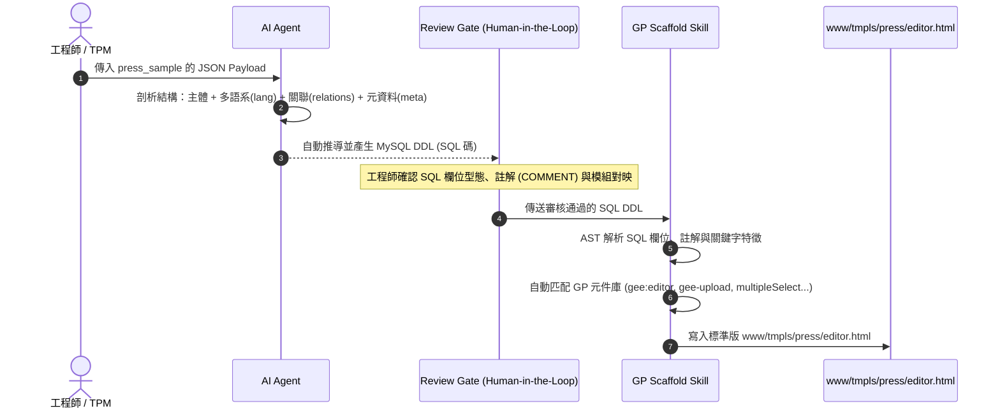

### Step 1: 澄清與定義 (Clarify & Define)

**演練目標與案例說明**：
本演練採用真實文章實例 JSON 進行管線實作。該 JSON 包含主表屬性（如 `status`、`mode`、`cover`、`banner`）、多語系結構 `press_lang`（包含標題 `title`、摘要 `info` 與富文本 `content`）、動態元資料 `press_meta`，以及多對多關聯陣列（如 `press_tag`、`press_author`、`press_related`、`press_term`）。

我們將展示如何透過全新的 **「Data-Driven Schema-First Scaffold Pipeline」**，完成從 JSON Payload 到最終生成 **Gene Panel (`www/tmpls/press/editor.html`)** 規範化 HTML 的完整自動化流程。


#### press_sample json

```json
{
    "press":
    {
        "id": 1,
        "cate_id": 1,
        "layout": 4,
        "status": "Published",
        "mode": "Article",
        "on_homepage": "No",
        "on_top": "No",
        "slug": "3mhjhsslmhhhhynl",
        "online_date": "2026-11-03 09:19:00",
        "sorter": 99,
        "cover": "/upload/img/2026/11/03d76cacc15fb6c.jpg",
        "banner": "/upload/img/2026/11/12c4371c9ad49ef.jpg",
        "last_ts": "2026-11-03 09:45:03",
        "last_user": 1,
        "insert_ts": "2026-11-03 09:19:25",
        "insert_user": 1,
        "from_ai": "No",
    },
    "press_lang": [{        
    	"lang": "tw",
        "title": "用 40 分鐘Yoga NIdra，給累到失語的你一場神經系統修復提案",
        "subtitle": null,
        "info": "有一種疲憊，是累積了太久，久到失去訴說的力氣。當大腦因為慢性高壓而卡在「戰鬥模式」時，我們往往失去了停下來的能力。&#13;&#10;本文從功能醫學的自律神經機制與自然的沉穩錨點出發，解析「非睡眠深層休息（NSDR）」如何引導腦波降速修復，陪你卸下緊抓不放的重擔，找回身體的神經安全感。",
        "content": "<h4>地墊上的無聲故事：那句珍貴的「終於」</h4><p>上週課後，一位學生在收折地墊時，靜靜地抬起眼看著我。[2]</p><p>「老師，上了好幾次的課，今天的練習我終於感覺整個人鬆了下來。」[2]</p><p>那一瞬間，我心中有些鼻酸。因為我知道，她不只是累，而是累積了很久——那是累到連抱怨、訴說都失去力氣的虛脫。[2]</p><p>在四、五十分鐘的練習裡，她終於能夠安頓好自己。這個「終於」，在高速運轉的都會生活裡，極其珍貴。[2]</p><p>平靜躺在地墊上的每個人，姿態雖然安祥，內心其實都帶著各自的故事、未曾平復的壓力，以及生命留下的隱形傷疤。我們習慣咬牙支撐，直到身體發出過勞的警告，才發現自己早已忘了「鬆開」是什麼感覺。[2]</p><h4>科學觀點：為什麼大腦將「靜止」解讀為一種危險？</h4><p>為什麼我們明明極度疲憊，躺下來時大腦卻依然像失控的齒輪，轉個不停？[2]</p><p>從功能醫學的角度來看，這種「無法停下來」的現象，並不是你個性焦慮，而是自律神經系統切換失靈的生理反應。當你長期面對高壓環境，下視丘-腦垂體-腎上腺軸（HPA軸）失調，體內的皮質醇與腎上腺素持續處於高水位。[2]</p><p>此時，你的身體像是一個<strong>失靈的火災警報器</strong>。明明周遭安全無虞，警報器卻在體內二十四小時響個不停，將「靜止」與「失去控制」畫上等號。[2]</p><p>在這種警報未解除的神經機制下，大腦會本能地抗拒休息。這不是你的錯，而是在神經系統尚未獲得物理性的「安全訊號」之前，強迫自己靜心，只會帶來更深的內耗與焦慮。[3]</p><h4>自然智慧：給風一般的思緒，放下一塊大地的錨點</h4><p>在大自然的語言裡，這種停不下來的混亂思緒，就像是一陣乾燥的強風，吹亂了平靜的湖面。當體內的風元素過度波動，身體的消化與代謝能力便會隨之冷卻，使我們感到乾枯且容易受挫。[3]</p><p>風的特質是游移、不安定的。要平息體內的風暴，我們不能強行與風對抗，而是要在這股波動的底層，放下一塊沉穩的大地磚石，提供身體一個重量與錨點。[3]</p><p><strong>「非睡眠深層休息」（NSDR, Non-Sleep Deep Rest）</strong>就是這塊溫柔的磚石。[3]</p><p>它不是魔法，不需要你動用任何意志力去「努力放鬆」。在第一次練習時，它能帶給你久違的鬆弛感；而在持續的練習中，它會透過微米級的感知引導，帶領大腦的腦波從焦慮的高頻 β 波，漸進降速至深度修復的 θ 波。[3]</p><p>當副交感神經啟動，體內的火災警報器才會真正沉寂下來，向每一根緊繃的神經發送訊號：「危險解除了，現在很安全。」 唯有當身體感覺到安全，那些真正緊抓不放的重擔，才會一點一點地慢慢放下。[3]</p><h4>生命的定製工程：你不需要再努力，只需要回到自己</h4><p>Onenesslife 相信，健康不是流水線上的工業複製品，而是一場關於「回歸自我」的精密設計。[4]</p><p>我們拒絕提供標準化的放鬆公式，也不需要你成為完美的修行者。你不需要看著鏡子裡的自己皺眉、嘆氣或挑剔，更不需要去符合任何人期望的標準。「你看起來不錯」不是最好的稱讚，「你感覺自在」才是。[4]</p><p>你的疲憊、你的焦慮，甚至是那些藏在體內的傷疤，都是你努力生活過的痕跡，不需要被粗暴地修正。身體不是要被修正的錯誤，而是你可以選擇好好共處的家。[4]</p><p>如果最近的你，也覺得撐得太累、電池快要耗盡。請記得，你不需要再努力，你只需要一個地方放鬆下來，讓身體從隨時備戰的戰場，變回溫柔的家。[4]</p><p><strong>【靜心提案】</strong>這個週末，別再把時間填滿待辦事項。預約一場屬於你的神經修復練習，<strong>讓自己放三個小時的假</strong>。[4]</p>"
    }],
    "press_meta": {
        "_video_id": "IcVV8BUsLr4",
        "play_icon": "no",
        "txt_algin": "left",
        "txt_color": "dark",
        "btn_txt": "see more"
    },
    "press_tag": [{
        "press_id": 1,
        "tag_id": 2,
        "sorter": 1
    }],
    "press_author": [{
        "press_id": 1,
        "author_id": 2,
        "sorter": 1
    }],
    "press_related": [{
        "press_id": 1,
        "related_id": 2,
        "sorter": 1
    }],
    "press_term": [{
        "press_id": 1,
        "term_id": 2,
        "sorter": 1
    }]
}
```

---

### Step 2: 拆解與規劃 (Decompose & Plan)

#### Pipeline 四大執行階段 (The 4-Stage Pipeline)



---

#### 階段 1：傳入 JSON 實例 (Input Payload)
擷取自 `press_sample` 之資料結構特徵：
* **主實體 (`press`)**：`cate_id`, `status` ("Published"), `mode` ("Article"), `cover` (.jpg), `banner` (.jpg), `online_date`
* **多語系 (`press_lang`)**：`title`, `subtitle`, `info` (摘要), `content` (含 HTML 標籤之文章長內文)
* **元資料 (`press_meta`)**：`_video_id`, `play_icon`, `btn_txt`
* **多關聯對映 (`press_tag`, `press_author`, `press_related`)**：多選標籤、作者、相關推薦文章

---

#### 階段 2：AI 自動推導 SQL DDL (Schema Synthesis)
AI 解析 JSON 特徵後，自動產出標準化的 MySQL Schema：

```sql
-- 1. 文章主表
CREATE TABLE `tbl_press` (
  `id` INT AUTO_INCREMENT PRIMARY KEY COMMENT '文章ID',
  `cate_id` INT NOT NULL COMMENT '分類|module:press_category',
  `layout` TINYINT DEFAULT 1 COMMENT '版型樣式',
  `status` ENUM('Draft', 'Published', 'Archived') DEFAULT 'Published' COMMENT '發布狀態',
  `mode` ENUM('Article', 'Video', 'Gallery') DEFAULT 'Article' COMMENT '文章模式',
  `on_homepage` ENUM('Yes', 'No') DEFAULT 'No' COMMENT '首頁推薦',
  `on_top` ENUM('Yes', 'No') DEFAULT 'No' COMMENT '置頂顯示',
  `slug` VARCHAR(64) COMMENT '網址 Slug',
  `online_date` DATETIME COMMENT '上線時間',
  `sorter` INT DEFAULT 99 COMMENT '排序權重',
  `cover` VARCHAR(255) COMMENT '封面圖|upload',
  `banner` VARCHAR(255) COMMENT '橫幅大圖|uploadDnD',
  `author_ids` VARCHAR(255) COMMENT '作者選擇|module:author',
  `tag_ids` VARCHAR(255) COMMENT '標籤選擇|module:tag',
  `related_ids` VARCHAR(255) COMMENT '相關推薦|module:press',
  `meta_video_id` VARCHAR(100) COMMENT 'YouTube影片ID',
  `created_at` DATETIME DEFAULT CURRENT_TIMESTAMP COMMENT '建立時間'
) ENGINE=InnoDB DEFAULT CHARSET=utf8mb4 COMMENT='新聞稿與文章主表';

-- 2. 文章多語系內容表
CREATE TABLE `tbl_press_lang` (
  `id` INT AUTO_INCREMENT PRIMARY KEY,
  `press_id` INT NOT NULL COMMENT '主表關聯ID',
  `lang` VARCHAR(10) NOT NULL COMMENT '語系代碼',
  `title` VARCHAR(255) NOT NULL COMMENT '文章標題',
  `subtitle` VARCHAR(255) COMMENT '副標題',
  `info` TEXT COMMENT '摘要說明',
  `content` LONGTEXT COMMENT '詳細內文|editor',
  UNIQUE KEY `uk_press_lang` (`press_id`, `lang`)
) ENGINE=InnoDB DEFAULT CHARSET=utf8mb4 COMMENT='新聞稿多語系內容表';
```

---

#### 階段 3：工程師審核檢查點 (Human-in-the-Loop Review)
工程師檢查點：
1. 確定 `cover` 使用單圖上傳 `gee-upload`。
2. 確定 `banner` 使用多圖/寬圖拖放上傳 `gee-uploadDnD`。
3. 確定 `content` 指定為 `gee:editor` (富文本編輯器)。
4. 確定 `author_ids` 與 `tag_ids` 正確標註為多選模組 `multipleSelect`。

---

#### 階段 4：Skill 解析 SQL 並生成 `www/tmpls/press/editor.html`

Skill 讀取已審核的 SQL 碼後，產出符合 GP 規範的 HTML 編輯表單：

```html
<!-- www/tmpls/press/editor.html -->
<form class="gee" data-gene="init:loadRow,submit:setRow" data-tmpl="pressForm">
  <input type="hidden" name="id">

  <!-- 多語系分頁卡片 / 區塊 -->
  <div class="box">
    <h3 class="title is-4">文章內容 (繁體中文)</h3>
    <div class="field">
      <label class="label">文章標題</label>
      <p class="control">
        <input class="input" name="lang[tw][title]" type="text" placeholder="請輸入標題" required>
      </p>
    </div>

    <div class="field">
      <label class="label">副標題</label>
      <p class="control">
        <input class="input" name="lang[tw][subtitle]" type="text" placeholder="副標題">
      </p>
    </div>

    <div class="field">
      <label class="label">摘要說明</label>
      <p class="control">
        <textarea name="lang[tw][info]" class="textarea" placeholder="百字內摘要說明"></textarea>
      </p>
    </div>

    <div class="field">
      <label class="label">詳細內文</label>
      <p class="control">
        <gee:editor data-param="lang[tw][content]" data-inline="0"></gee:editor>
      </p>
    </div>
  </div>

  <!-- 分類與控制屬性 -->
  <div class="box">
    <h3 class="title is-4">屬性設定</h3>
    
    <div class="field">
      <label class="label">文章分類</label>
      <p class="control">
        <span class="select">
          <gee:set-option module="press_category" name="cate_id"></gee:set-option>
        </span>
      </p>
    </div>

    <div class="field">
      <label class="label">發布狀態</label>
      <input type="radio" class="is-checkradio" name="status" value="Published" id="press-status-pub" checked>
      <label class="radio" for="press-status-pub">已發布</label>
      <input type="radio" class="is-checkradio" name="status" value="Draft" id="press-status-draft">
      <label class="radio" for="press-status-draft">草稿</label>
    </div>

    <div class="field">
      <label class="label">上線時間</label>
      <p class="control">
        <input type="datetime-local" class="datetime-local input" name="online_date">
      </p>
    </div>
  </div>

  <!-- 媒體與圖片上傳區塊 -->
  <div class="box">
    <h3 class="title is-4">媒體與圖片</h3>
    
    <div class="field">
      <label class="label">封面圖 (Cover)</label>
      <gee-upload module-name="press" data-param="cover" info-text="建議尺寸 400x400"></gee-upload>
    </div>

    <div class="field">
      <label class="label">橫幅大圖 (Banner)</label>
      <gee-uploadDnD module-name="press" multiple="false" data-param="banner" info-text="建議寬度 1440px"></gee-uploadDnD>
    </div>

    <div class="field">
      <label class="label">YouTube 影片 ID</label>
      <p class="control">
        <input class="input" name="meta[_video_id]" type="text" placeholder="例如：IcVV8BUsLr4">
      </p>
    </div>
  </div>

  <!-- 關聯資料設定 -->
  <div class="box">
    <h3 class="title is-4">標籤與關聯設定</h3>
    
    <div class="field">
      <label class="label">作者選擇</label>
      <div class="control">
        <input type="text" multiple class="multipleSelect" name="author_ids" placeholder="搜尋作者" data-url="author/get_opts">
      </div>
    </div>

    <div class="field">
      <label class="label">標籤選擇</label>
      <div class="control">
        <input type="text" multiple class="multipleSelect" name="tag_ids" placeholder="搜尋標籤" data-url="tag/get_opts">
      </div>
    </div>

    <div class="field">
      <label class="label">相關推薦文章</label>
      <div class="control">
        <input type="text" multiple class="multipleSelect" name="related_ids" placeholder="搜尋相關文章" data-url="press/get_opts">
      </div>
    </div>
  </div>

  <!-- 表單操作按鈕 -->
  <div class="field is-grouped">
    <p class="control">
      <button class="button is-primary" type="submit">儲存文章</button>
    </p>
    <p class="control">
      <button class="button is-light gee" data-gene="click:closeModal" type="button">取消</button>
    </p>
  </div>
</form>
```

---

### Step 3: 風險與緩解 (Risks & Mitigation)

1. **複雜多語系矩陣結構解析風險 (Multilingual Array Parsing)**：
   * **風險**：JSON 中 `press_lang` 為陣列結構，若 SQL 生成時未分離為獨立多語系表，會導致 HTML 生成扁平無層次的欄位。
   * **緩解計畫**：AI 辨識到含有 `lang` 鍵值的陣列時，自動拆解為 `tbl_{entity}_lang` 輔助表，並在 HTML 生成時產出 `lang[locale][field]` 命名空間。
2. **多對多關聯陣列對映 (Relation Array Mapping)**：
   * **風險**：JSON 中的 `press_tag` 陣列包含多筆物件 (`[{tag_id: 2}, ...]`)，不易直接映射為單一 HTML 欄位。
   * **緩解計畫**：AI 在產生 SQL 時自動將其收斂為 `tag_ids` 欄位，並將 HTML 元件自動指定為 `multipleSelect`（附帶 `data-url="tag/get_opts"`），維護前端開發簡潔性。

---

### Step 4: 執行與溝通 (Execution & Communication)

**Stakeholder Update (TL;DR)**：

**TL;DR - 以 `press_sample` 實例演練 Pipeline 之成果**
 
* **演練結論**：驗證了從真實複雜 JSON（含多語系 `press_lang`、多對多關聯 `press_tag` / `press_author` 與多媒體 `cover`/`banner`）自動轉換為 MySQL Schema，最終精準產出 GP 規範 HTML 表單（含 `gee:editor`、`gee-upload` 與 `multipleSelect`）的全自動化流程。

* **效益評估**：以往需花費 1-2 小時手動拆解多語系與關聯欄位的複雜文章模組，現透過本 Scaffold Skill Pipeline，**可在 3 分鐘內完成精準且 100% 契約對齊的後台樣板搭建**。